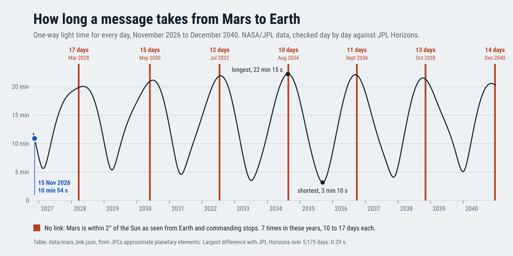

# SOSpesAI

A daily health check-in for crews far from Earth. It runs in a browser on one laptop, with no server.

It does two things:

1. **It measures with what a crew already has: a microphone and a camera.** Thirty seconds of speech, one held "aaaa" and the laptop camera give more than twenty signals: speech rate, pauses, voice steadiness, breath support, blinks, eyelid closure, yawns, head posture and an experimental pulse. Each signal is compared with that person's own baseline, never with a population average.
2. **It works out who should decide: Earth, both, or the crew.** For a mission, a date and a medical situation, it compares how long Earth needs to answer (light time, link outages, ground response) with how long the crew can wait.

Built in Seville for the NASA Space Apps Challenge 2026, challenge *Create Health Monitoring Software for Astronauts on Space Missions*.

> **Not a medical device.** SOSpesAI estimates and compares. It does not diagnose and it never names a condition from the signals. Its strongest output is amber, which means "run the standard check". All crew data in this repository are synthetic.

## Why "who decides" changes with distance

In January 2026 the International Space Station had its [first medical evacuation](https://www.news4jax.com/news/florida/2026/01/15/nasa-sends-4-astronauts-back-to-earth-in-first-medical-evacuation/): the crew was back on Earth less than eleven hours after undocking. On the way to Mars that option does not exist, and even advice arrives late.

On 15 November 2026 a message takes 654 seconds, just under 11 minutes, to travel from Mars to Earth. The fastest possible answer to a medical question therefore takes about 37 minutes: almost 22 minutes of light travel there and back, plus the time the ground team needs to read and reply (we assume 15 minutes). From 13 to 29 March 2028 Mars is within 2° of the Sun as seen from Earth and there is no reliable link at all.

| Situation (time to act) | Mars at its closest, 11 Sep 2035: Earth answers in 22 min | Mars, 15 Nov 2026: 37 min | Mars, 20 Mar 2028: no link for 9 more days |
|---|---|---|---|
| Chemical eye burn (5 min) | The crew decides | The crew decides | The crew decides |
| Suspected stroke (60 min) | Decide together | Decide together | The crew decides |
| Kidney stone, renal colic (4 h) | Earth leads | Earth leads | The crew decides |

The engine reduces each case to one number, `A = time for Earth's answer / time the crew can wait`. A kidney stone on Mars on 15 November 2026 gives 37 min / 240 min, about 0.15.

- `A ≤ 0.25`: Earth leads and the crew carries it out.
- `0.25 < A ≤ 1`: decide together. The crew starts the actions that cannot make things worse, sends a summary and re-checks when Earth's answer arrives.
- `A > 1`: the crew decides and reports afterwards.

Even on the space station, where the ground can answer in about 15 minutes, the crew decides for a chemical eye burn: there are only 5 minutes.

The times to act, the 15 minute ground response and the two thresholds are team assumptions. A clinician has not validated them yet; they are marked `TO_VALIDATE` in `data/condition_cards.json`.



Between November 2026 and December 2040 the one-way light time goes from 3 min 10 s (September 2035) to 22 min 15 s (August 2034). The link is lost seven times, for 10 to 17 days, when Mars passes behind the Sun. The figure is drawn from the table in this repository with `node tools/make_link_figure.mjs`.

NASA's plan for [Earth-independent medical operations](https://ntrs.nasa.gov/api/citations/20230016189/downloads/EIMO_OVERVIEW_IWS24.docx) expects ground advice to be "significantly delayed" on such missions and names, as an advanced feature of its future decision-support system, passive monitoring that picks up early warning signs. SOSpesAI is a small working sketch of that idea.

## Body language, encryption and AI: what is really inside

Three things health apps often claim. This is what stands behind each one here.

**Body language.** The camera already follows the face, so the same model also gives the posture of the head: how much it moves, how far it tilts to one side and how often it settles in a new position. An optional second model adds the shoulders and the trunk: shoulder tilt, trunk movement and how high the head sits over the shoulders, which drops when a person slumps. These are numbers about behaviour, compared with the person's own usual. They cannot read pain, mood or intent. Two published results explain why they are worth watching. People moved their head less, and more slowly, when their depression was more severe ([Girard et al., 2014](https://pmc.ncbi.nlm.nih.gov/articles/PMC4217695)). And work funded by NASA through the National Space Biomedical Research Institute followed the face with a camera to detect stress during demanding tasks; it was right 68 % of the time in 60 healthy adults ([Dinges et al., 2005](https://www.ic.unicamp.br/~siome/papers/dinges-asma05.pdf); Metaxas et al., 2007, doi:10.1016/j.actaastro.2006.09.003). In weightlessness the body takes a "neutral body posture", and NASA's study on shuttle mission STS-57 found that it differs from one person to the next ([NASA Spinoff](https://spinoff.nasa.gov/node/11046)). One more reason to compare each person only with themselves.

**Encryption.** Audio and video never leave the browser. What leaves is a summary in numbers, and it is encrypted on the device before it is sent: AES with a 256-bit key in Galois/Counter Mode, through the Web Crypto API that every browser carries. It is the choice of CCSDS, the body that writes the data standards of the space agencies, for new missions ([CCSDS 352.0-B-2](https://public.ccsds.org/pubs/352x0b2.pdf)): AES, 256-bit keys, and GCM when a message must be both secret and authenticated. Each message carries a counter that only goes up, so a key never meets the same starting value twice and a replayed message is refused. Encryption adds 28 bytes to a summary of 2 to 4 kB. NASA's own standard asks for this privacy: medical communications that travel through the spacecraft link "shall be considered private communication" ([NASA-STD-3001 Vol. 1, V1 6003](https://www.nasa.gov/reference/6-0-medical-operations/)), and when a mission has communication delays it allows stored and forwarded messages instead of live calls. What this is not: key management. The demo creates its key in the browser; a mission would load it before launch into protected hardware.

**AI.** Two kinds, kept apart. *Seeing* is done by neural networks that run inside the browser: Google's MediaPipe Face Landmarker gives 478 points of the face and 52 expression scores for every video frame, and the optional Pose Landmarker gives 33 points of the body. Their model cards state the Apache-2.0 licence, and the card of the face model says its output does not identify people and is not meant for life-critical decisions. *Judging* is not a black box. The app learns what is normal for one person from that person's own check-ins, then measures how far today is from it, signal by signal and all together. NASA uses the same principle to watch the space station's systems from the flight control room: its Inductive Monitoring System learns normal behaviour from the system's own data and reports the distance from it ([NASA Ames](https://ntrs.nasa.gov/api/citations/20090037065/downloads/20090037065.pdf)). Ours is the simplest form of that idea, one centre and one spread per signal, with three rules anyone can read: one signal far from the baseline, two signals clearly away, or four signals a little away at the same time and from two different sensors. Nothing is trained on crew data, and there is no generative AI in the product.

## Try it in two minutes

```
git clone -b modules-en https://github.com/sophiarequiao/nasa-space-apps.git
cd nasa-space-apps
python -m http.server 8000
```

Open `http://localhost:8000/tools/demo.html` in a recent Chrome or Edge. Any static file server works; Python is only used to serve the files.

1. At the top, choose a mission, a date and a situation. The page shows the light time, a to-scale line between the two worlds, the radiation that mission adds (NASA measurements and estimates, with their sources), the calendar of the whole table (click any day) and the verdict, with the steps to start now and the red flags of that situation.
2. In the daily check-in choose **Simulated, rested** or **Simulated, tired** to see it work without a camera. With **Live sensors**, allow the microphone and the camera and talk for 30 seconds.
3. The read-out places each signal against the personal baseline. The baseline exists after two saved check-ins and is kept only in this browser.
4. **Send this check-in to Earth** shows the summary travelling with the real light time of that date.

## NASA data and resources used

| Resource | What we use it for | Where |
|---|---|---|
| JPL Solar System Dynamics, [Approximate Positions of the Planets](https://ssd.jpl.nasa.gov/planets/approx_pos.html) | Earth to Mars light time and Sun-Earth-Mars angle for every day from 2026-11-01 to 2040-12-31 | `tools/generate_earth_mars_link.py`, `data/mars_link.json` |
| [JPL Horizons](https://ssd.jpl.nasa.gov/horizons/) (ephemeris DE441) | Independent check of that table | `data/horizons_reference.json`, `tools/check_horizons.mjs` |
| JPL news release on the [Mars solar conjunction](https://www.jpl.nasa.gov/news/mars-missions-to-pause-commanding-in-june-due-to-sun/) | Rule "no commands while Mars is within 2° of the Sun" | `src/engine/link.js` |
| NASA [Moon Fact Sheet](https://nssdc.gsfc.nasa.gov/planetary/factsheet/moonfact.html) | Earth to Moon distance, 384,400 km, 1.28 s | `src/engine/link.js` |
| NASA Human Research Program, [Integrated Medical Model v3.0 report](https://www.nasa.gov/wp-content/uploads/2026/08/mars-transit-iva.pdf) for a 16-month Mars transit with four crew (2017) | Which situations are on the cards: its top drivers of evacuation (eye chemical burn, skin infection, urinary infection, shingles, kidney stone) and of loss of crew life (sepsis, smoke inhalation, stroke, appendicitis) | `data/condition_cards.json`, field `nasa_basis` |
| NASA Office of the Chief Health and Medical Officer, [Urinary Health technical brief](https://www.nasa.gov/wp-content/uploads/2025/01/ochmo-mtb-003-urinary-health.pdf) (OCHMO-MTB-003) | Why a kidney stone is the main example: 43 stone events recorded in 29 crew members, and the second most likely reason for an emergency evacuation from the station in NASA's model | `data/condition_cards.json` |
| NASA Space Flight Human-System Standard, [NASA-STD-3001 Vol. 1, section 6.2](https://www.nasa.gov/reference/6-0-medical-operations/), private medical communication | Why the summary is encrypted before it leaves, and why a stored message is acceptable when the link has a delay | `src/engine/seal.js` |
| NASA Ames, [Inductive Monitoring System](https://ntrs.nasa.gov/api/citations/20090037065/downloads/20090037065.pdf), used in the space station flight control room | The principle of the early warning: learn normal from the system's own data, measure the distance from it | `src/engine/earlyWarning.js` |
| NASA [neutral body posture](https://spinoff.nasa.gov/node/11046) research (Skylab, STS-57) | Why posture is compared with the person's own baseline and not with a standard posture | `src/sensors/face.js`, `src/sensors/body.js` |
| NASA Mars Science Laboratory, RAD instrument (Radiation Assessment Detector): [cruise to Mars](https://swri.org/node/9140), Zeitlin et al., Science 340, 1080 (2013), and [surface of Mars](https://swri.org/node/9079), Hassler et al., Science 343, 1244797 (2014) | Radiation measured on the way to Mars (1.8 mSv a day inside the spacecraft, 2011-2012) and on its surface (0.67 mSv a day at Gale crater, 2012-2013) | `data/radiation.json`, `src/engine/radiation.js` |
| NASA Office of the Chief Health and Medical Officer, [Radiation Protection technical brief](https://www.nasa.gov/wp-content/uploads/2023/03/radiation-protection-technical-brief-ochmo.pdf) (OCHMO-TB-020), NASA-STD-3001 Vol. 1 | NASA's career limit for space flight radiation, 600 mSv, against which every mission is read | `data/radiation.json` |
| NASA, Simonsen, Zawaski and Weeks, [Moon 2 Mars: Space Radiation Protection](https://ntrs.nasa.gov/api/citations/20250006168/downloads/ASCEND%20Simonsen%20draft%201.pdf) (NTRS 20250006168) | Radiation inside the space station (0.2 to 0.5 mSv a day) and NASA's estimates for a short lunar mission, a stay on the Moon and a whole Mars mission (1,000 to 1,200 mSv) | `data/radiation.json` |
| NASA paper on medical risk for a long lunar mission with the IMPACT tool, [NTRS 20240011063](https://ntrs.nasa.gov/citations/20240011063) | Background for the evacuation notes of the lunar profiles | `data/mission_profiles.json` |

The Integrated Medical Model report was run with the medical kit of the space station and itself advises caution when reading it for Mars; we use it only to choose which situations to show. The evacuation times in the mission profiles are still being confirmed against the full text of the lunar paper. The radiation figures are averages for the periods measured: they change with shielding and with the solar cycle and leave out a large solar storm, the two for Mars are dose equivalent from galactic cosmic rays while the station and the Moon are effective dose, and the Moon has NASA estimates, not measurements. The page shows them as context for the mission chosen; it does not add up anybody's dose.

This project uses NASA data and is not endorsed by NASA. No NASA logos or insignia are used.

## How well does it work

| Part | How it was checked | Result | Still open |
|---|---|---|---|
| Earth to Mars link | Every day from 2026 to 2040 (5,175 days) against JPL Horizons | Light time within 0.29 s (0.05 %), angle within 0.04°, the solar conjunction windows match on all days but one | Relay orbiters and the local horizon on Mars are not modelled |
| Who decides | 14 reference cases from the team's first Python version | All match | Times to act and thresholds need clinical validation |
| Voice message | Synthetic speech with known rate, pauses and pitch; 10 real recordings of one speaker | Detects speech 14 % slower than the baseline | Under-counts syllables in fast speech; one speaker |
| Held vowel | Synthetic vowels with known jitter and shimmer; 10 real recordings of one speaker on a laptop microphone in a noisy room | A normal and a hoarse vowel are clearly apart (jitter 0.14-0.18 % against 0.35 %, harmonicity 15-17 dB against 8.6 dB) | Values read about half of what clinical software gives; only comparable with the person's own baseline |
| Eyelids | Synthetic blink scores; 3 minutes of one person | Blink rate 8 per minute at rest and 19 blinking on purpose; eyelid closure 1 % at rest and 36 % with slow closures | Looking down reads as eyes closing |
| Pulse from the camera (experimental) | Synthetic signals, 150 noise-only simulations, two 3-minute recordings of one person | Shows nothing on noise; follows the recovery after exercise from 139 to 104 beats per minute in 45 s | No reference device yet; it stays silent rather than guess, so some check-ins have no pulse |
| Face symmetry check (experimental) | Synthetic scores only | The logic behaves as designed | Not tried on a real case; wording to be approved by the health lead |
| Head posture and movement (experimental) | Synthetic positions; two real recordings of one person (still, talking, moving); a reference portrait turned and moved by known amounts in front of the real model | Head movement 1.1 to 2.8 % of the face width per second still, 3.8 to 9.4 talking, 10.8 to 12.2 moving. A turn of 12° reads 11.8°, a sway of 5 % per second reads 4.6, one move to a new place reads as one posture shift | Not yet tried live with these numbers on screen; the camera position changes the reading; fast nods are averaged out; nothing says what a change means |
| Shoulders and trunk (experimental, optional) | Synthetic poses; the same reference portrait | A turn of 12° reads 12.1°; the head height over the shoulders stays within 0.1 point | Never tried on a live person by the team; needs both shoulders in view; a second model slows an old laptop |
| Encryption of the summary | Test Cases 13 and 14 of the GCM specification; same bytes as OpenSSL; a changed bit, another key and a replayed message | 20 of 20 checks as expected | No key management; not audited |
| Radiation by mission | 18 checks of the numbers and of the arithmetic against the sources | 1.8 mSv a day reaches NASA's career limit of 600 mSv in about 333 days, 0.67 in about 896; six months at the station rate give 36 to 90 mSv, where NASA gives 40 to 90 | Averages, not a dosimeter; no solar storm; the Moon figures are estimates; the three sources still have to be opened by a second person of the team |
| Early warning | 15 synthetic cases | As designed | The rules (1.5, 2 and 3 standard deviations) are team assumptions; the rule for several small changes is new and not yet reviewed by the health lead |

Run the checks yourself (Node 18 or later, nothing to install):

```
node tools/check_horizons.mjs      # Mars table against NASA/JPL Horizons
node tools/test_link.mjs
node tools/test_authority.mjs
node tools/test_voice.mjs
node tools/test_vowel.mjs
node tools/test_face.mjs           # eyelids, facial movement, head posture
node tools/test_body.mjs           # shoulders and trunk
node tools/test_early_warning.mjs
node tools/test_rppg.mjs
node tools/test_seal.mjs           # encryption: published vectors, OpenSSL, tampering, replay
node tools/test_radiation.mjs      # radiation by mission: NASA figures, career limit, sources
```

In a browser, `tools/test_camera_models.html` checks the two camera models without a camera: it shows them a reference portrait that is turned and moved by known amounts, and compares what they report (about 70 seconds, needs internet).

## What is in the repository

| Path | Content |
|---|---|
| `src/engine/link.js` | Light time and link outages for each mission |
| `src/engine/authority.js` | Who decides: Earth, both or the crew |
| `src/engine/earlyWarning.js` | Change from the personal baseline: silent, green or amber |
| `src/engine/seal.js` | Encryption of the summary that is sent to Earth (AES-256-GCM) |
| `src/engine/radiation.js` | Radiation each mission adds, from NASA measurements and estimates, against NASA's career limit |
| `src/sensors/voice.js` | The 30 second voice message and the held vowel |
| `src/sensors/face.js` | Eyelids, yawns, facial movement, head posture and the guided symmetry check |
| `src/sensors/body.js` | Optional: shoulders and trunk |
| `src/sensors/rppg.js` | Experimental pulse from the camera |
| `data/` | Mars link table 2026-2040, Horizons reference, mission profiles, condition cards, radiation by mission |
| `docs/` | Figure of the Mars link, drawn from the table |
| `tools/demo.html` | The whole flow in one page |
| `tools/` | Tests for Node (`*.mjs`), test pages for the browser (`test_*.html`), the Python scripts that built the Mars table |
| `vendor/mediapipe/` | MediaPipe Tasks Vision 1.2.3, unmodified |
| `MODULES.md` | Integration guide: functions, data formats, limits |

The modules are plain ES modules with no dependencies, so an app can import them directly.

## Privacy

Audio and video are analysed inside the browser. They are never stored and never sent anywhere; only the resulting numbers are kept, in the browser's local storage. The summary that is sent to Earth is encrypted on the device first (`src/engine/seal.js`). The baseline kept in the browser is not encrypted. Test recordings are kept out of the repository.

The only network requests the demo makes are the first download of the MediaPipe face model (3.8 MB) and, if the option for shoulders and trunk is on, of the pose model (5.8 MB), both from Google's public model storage. Place the files in `vendor/mediapipe/` to run fully offline (see `vendor/mediapipe/README.md`).

## Licences

- Our code and data files: MIT (see `LICENSE`).
- MediaPipe Tasks Vision 1.2.3: Apache-2.0, vendored unmodified in `vendor/mediapipe/`. The model files are downloaded from Google and are not redistributed here. Their model cards state the Apache License 2.0: [Face Mesh V2](https://storage.googleapis.com/mediapipe-assets/Model%20Card%20MediaPipe%20Face%20Mesh%20V2.pdf), [Blendshape V2](https://storage.googleapis.com/mediapipe-assets/Model%20Card%20Blendshape%20V2.pdf) and [BlazePose GHUM 3D](https://storage.googleapis.com/mediapipe-assets/Model%20Card%20BlazePose%20GHUM%203D.pdf).
- Encryption: the Web Crypto API of the browser. No cryptography library is included.
- Fonts: system fonts only. No images or icons from third parties.

## Use of AI

The code, the tests and this documentation were drafted with AI assistance (Claude, by Anthropic) and reviewed and tested by the team. Every source file says so in its header. There are no AI-generated images, audio or video in this repository.

Inside the product, the AI is two pre-trained neural networks from Google's MediaPipe that read the camera on the device. There is no generative AI in the product and nothing is trained on crew data.

## Team

Team SOSpesAI, NASA Space Apps Challenge 2026, Seville: technical lead, health lead and presenter, app developer, sources and licences, data and validation.
